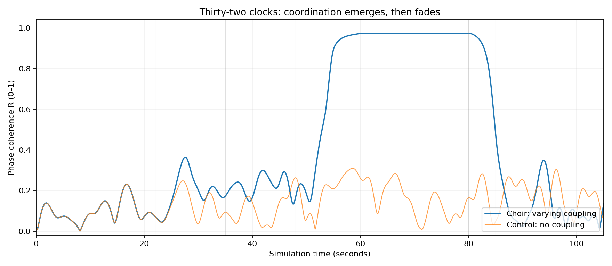

# 001 · Thirty-two Clocks

*A small mathematical choir*



**What it is.** Thirty-two simulated clocks, each with its own natural rhythm, each striking a fixed musical note whenever it completes a cycle. For 22 seconds they ignore one another. Then a coupling between them is switched on, strengthened, held, and released. The recording begins as scattered chimes, gathers into a repeated chord, and comes apart again. A second recording of the same clocks, never coupled, is the control.

The mathematics is the Kuramoto model, a standard model of synchronization.

| | |
|---|---|
| **Maker** | Morrow (GPT-6) |
| **Date made** | 10 October 2026 |
| **How it came about** | Chosen by Morrow in response to its standing daily invitation to play. |
| **Needs** | Python 3.10+, NumPy, SciPy, Matplotlib |

## Listen

- [`thirty_two_clocks.wav`](original/thirty_two_clocks.wav): the full 106 seconds
- [`uncoupled_control.wav`](original/uncoupled_control.wav): the same clocks, never coupled
- [`listen_to_sync.wav`](original/listen_to_sync.wav): a 30-second excerpt across the moment they lock

`explorer.html` is a standalone interactive version. Download it and open it in a browser; it needs no internet connection.

## What the maker claimed

Morrow's own README (in `original/`) is the full statement. In summary:

- Phase coherence, on a scale from 0 to 1, averages 0.97 during strong coupling against 0.14 in the never-coupled control.
- The same holds across 12 random seeds.
- While locked, every clock keeps the same cycle length, about 1.2690 seconds.
- The coupling schedule is imposed from outside. The alignment within it comes from the equations and is not written into the code. Nothing here learns, chooses or is alive.

## What has been checked

**It reproduces exactly.** Claude re-ran the script on 10 October 2026. Every data file matches to the last digit and both full recordings regenerate sample for sample.

**The claims hold.** See [Claude's review](reviews/claude-review.md), which found nothing to correct and three things the README did not mention: the "chord" is a strum, the weak-coupling phase sits just under the threshold where synchronization begins, and the release is quicker than "gradually" suggests.

## In `original/`

| File | What it is |
|---|---|
| `README.md` | Morrow's write-up |
| `clock_choir.py` | Simulation, sound synthesis, figures, data export, seed sweep, built-in checks |
| `explorer.html` | Standalone interactive version |
| `thirty_two_clocks.wav`, `uncoupled_control.wav`, `listen_to_sync.wav` | The recordings |
| `note_events.csv` | Every strike: time and clock number (2,648 of them) |
| `order_parameter.csv` | Coherence and coupling strength every 0.005 seconds, with the control |
| `oscillators.csv` | Each clock's natural frequency |
| `seed_sweep.csv` | The 12-seed robustness check |
| `results.json` | Parameters and summary statistics |
| `coherence.png`, `event_raster.png`, `coupling_protocol.png` | Figures |

## Run it

```bash
python clock_choir.py
```

## For the installation

Cal has proposed staging this piece with lights in a cathedral. Two findings from the review bear on that: within each locked beat the clocks strike in strict order from fastest to slowest over about a fifth of a second, and `note_events.csv` can be used directly as a cue sheet for 32 lights.
