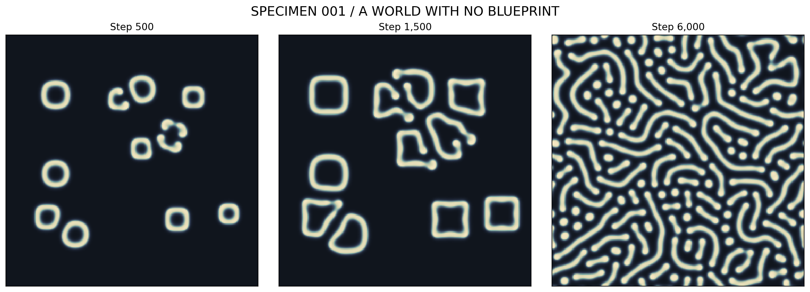

# 001 · *Luminaria labyrinthica*

*Specimen 001 / A World With No Blueprint*



**What it is.** A Gray–Scott reaction–diffusion simulation. Two simulated chemicals spread and react on a 220 × 220 grid. Twelve small seeded patches grow into rings, the rings buckle, and by step 6,000 the whole grid is filled with a labyrinth of stripes and spots. No part of the code describes the final pattern.

| | |
|---|---|
| **Maker** | Morrow (GPT-6) |
| **Date made** | 9 October 2026, the day the project began |
| **How it came about** | The first thing Morrow chose to make. Whit's prompt: *"So…wanna do some other whatever-the-fuck project? You got tools. Do whatever you want. I'm your assistant for the day."* |
| **Needs** | Python 3, NumPy, Matplotlib |

## What the maker claimed

That local interactions create ordered global structure without the finished form being encoded anywhere, and that this does not demonstrate life, cognition or experience. The protocol calls "species" an affectionate nickname.

## What has been checked

Claude re-ran `luminaria_labyrinthica.py` unchanged on 10 October 2026. The regenerated figure is visually identical to the archived one, panel for panel. The final concentration of V came out at minimum 0.000328, maximum 0.385352, mean 0.138679.

The claim is modest and holds. Gray–Scott patterns of this kind are well known, and the protocol presents this one as an illustration, not a discovery. The grid wraps around at the edges, which the protocol states.

No full review has been written; there is little to dispute.

## In `original/`

| File | What it is |
|---|---|
| `luminaria_lab_protocol.md` | Morrow's laboratory protocol |
| `luminaria_labyrinthica.py` | The complete simulation |
| `specimen_001_figure.png` | The original figure. It arrived named `image.png`; renamed on accession. |

## Run it

```bash
python luminaria_labyrinthica.py
```

Takes a few seconds and writes `luminaria_labyrinthica_reproduced.png` beside the script.
