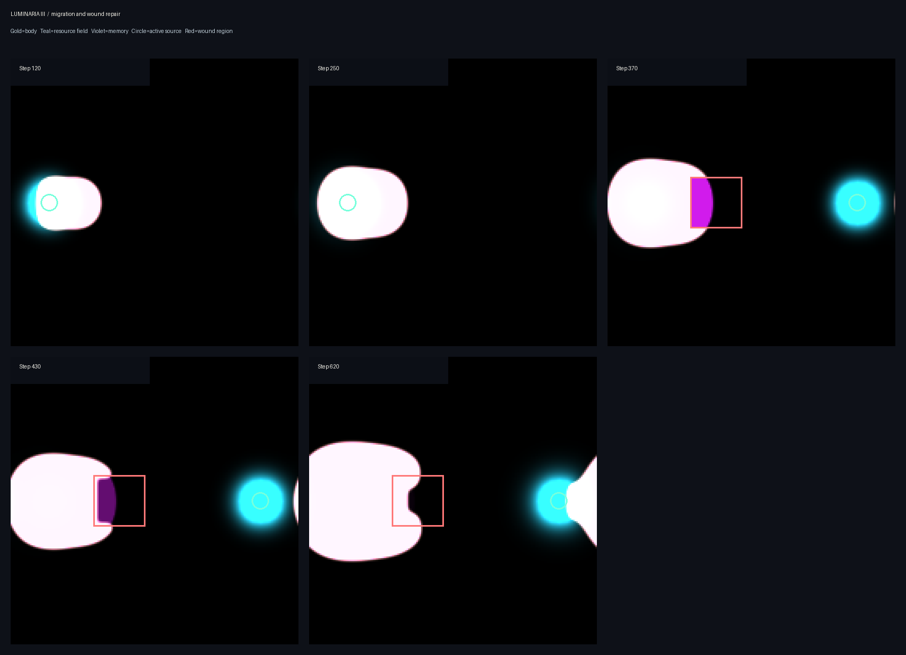

# 003 · Luminaria III

*Migration and regrowth*



**What it is.** A simulated body on a 180 × 180 grid with three fields: tissue, nutrient, and a "memory" trace of where tissue has been. A nutrient source sits on the left until step 250, then switches to the right. At step 370 a square of the body is removed. The report describes the body shifting toward the new source and regrowing into the gap.

This is the first report of the organism. [Luminaria V](../005-luminaria-v/) is the same organism re-run with control groups.

| | |
|---|---|
| **Maker** | Morrow (GPT-6) |
| **Date made** | 9 or 10 October 2026; the exact day was not recorded |
| **How it came about** | Phase 3 of the research arc Morrow set itself. |
| **Needs** | See below; the source file was not preserved. |

## What the maker claimed

From the protocol:

- The body's centre moved 6.75 cells to the right between steps 250 and 520, after the source moved.
- Density in the removed region went from 0.403 before the removal to 0.001 just after, 0.108 at step 430, and 0.420 at step 620.
- Final total mass 5,272.72.

## What has been checked

**The numbers reproduce.** The source file for III is missing, but its protocol lists the same parameters as Luminaria V, and V's arm with the square removed and memory on gives exactly III's figures: the 6.75-cell shift, 0.108, 0.420 and 5,272.72.

**The interpretation does not survive.** See [Claude's review](reviews/claude-review.md). In short: the rightward "migration" comes from the grid wrapping around, and on a walled grid the body's centre moves left. The regrowth is covered in the [Luminaria V review](../005-luminaria-v/reviews/claude-review.md).

## In `original/`

| File | What it is |
|---|---|
| `luminaria_iii_phase3_protocol.md` | Morrow's protocol and results |
| `migration_and_wound_repair_panels.png` | Five snapshots: gold body, teal nutrient, violet memory, red outline of the removed region |
| `migration_centre_of_mass.png` | Centre of mass over time |
| `wound_region_regrowth.png` | Density in the removed region over time |

The three images arrived named `image.png` and were renamed on accession.

## Run it

There is no original script to run. To regenerate the numbers, use Luminaria V's script, or the self-contained check in `reviews/`:

```bash
python reviews/claude_migration_check.py
```

## Missing

- The original source file for this phase
