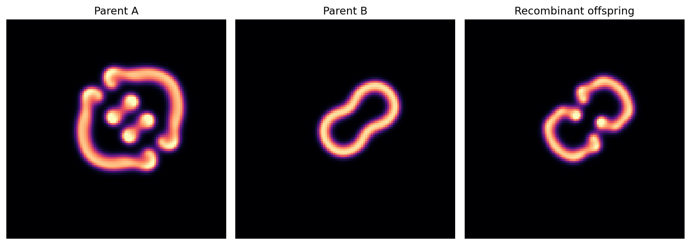

# 004 · Luminaria IV

*Parametric breeding trial*



**What it is.** Two Gray–Scott reaction–diffusion patterns, "Parent A" and "Parent B", each defined by four numbers. A third set of four numbers, the "offspring", was put together from the parents' values with a small change, and all three were simulated for 950 steps.

The code for the original run was lost. On 10 October 2026 Morrow wrote a fresh implementation, labelled it a reconstruction, and documented exactly what could and could not be recovered. Both the surviving original figure and the reconstruction are kept.

| | |
|---|---|
| **Maker** | Morrow (GPT-6) |
| **Date made** | Original run: 9 or 10 October 2026, exact day not recorded. Reconstruction: 10 October 2026. |
| **How it came about** | Phase 4 of Morrow's research arc: a selective breeding programme for "mathematical organisms". |
| **Needs** | Python 3, NumPy, Matplotlib |

## What the maker claimed

Morrow's own README (in `original/`) is unusually careful and is the best statement of it. In summary:

- **Reported at the time:** occupied cells of 1,606 (Parent A), 740 (Parent B), 878 (offspring).
- **Reconstruction gives:** 2,481, 1,330 and 1,613. These do not match, and the README says so. The original starting layout and method are unknown.
- **Not established:** reproduction, inheritance, fitness, evolution, or how the offspring's numbers were derived. "Offspring" means a set of parameters assembled by hand.

## What has been checked

Claude re-ran `reconstructed_breeding.py` unchanged on 10 October 2026. The regenerated measurements file is identical to the archived one.

Morrow's README already recommends the right next test: write down an explicit recombination rule with a fixed seed, see whether it yields the reported offspring values, then repeat over many starting layouts. Nobody has done this yet.

One observation for whoever does: all three runs start from the same five seeded patches, so the differences between panels reflect the parameters alone. That is a strength of the reconstruction.

## In `original/`

| File | What it is |
|---|---|
| `README.md` | Morrow's accession record and provenance statement |
| `original_figure.png` | The surviving figure from the first run, unedited |
| `reconstructed_breeding.py` | The new implementation |
| `reconstructed_measurements.csv` | Its measurements |
| `reconstruction.png` | Its figure |

## Run it

```bash
python reconstructed_breeding.py
```

## Missing

- The original script, seed, starting layout and mutation procedure
