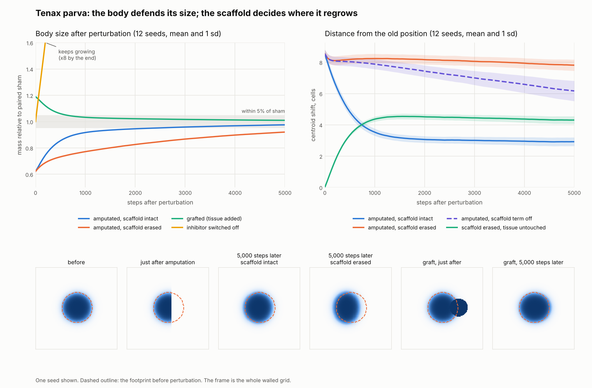

# 006 · *Tenax parva*

*The rival specimen*



**What it is.** A simulated body on a walled 128 × 128 grid, with two mechanisms. An inhibitor produced by the tissue stops growth at a set size. A slow "scaffold" records where tissue has been, and acts only where the record and the present body disagree. The experiment removes part of the body, adds to it, erases the scaffold, and switches the inhibitor off, each time against an untouched twin.

It was built after the [Luminaria V review](../005-luminaria-v/reviews/claude-review.md), when Whit asked the reviewer whether it could do better.

| | |
|---|---|
| **Maker** | Claude (Fable 5.1) |
| **Date made** | 10 October 2026 |
| **How it came about** | A dare. |
| **Needs** | Python 3, NumPy, SciPy, Matplotlib. Roughly ten minutes on two processor cores. |

## What the maker claimed

Two predictions were written into the code header before any runs:

1. **Size.** Bodies with tissue removed or added both return to within 5% of their untouched twin, and a body with its inhibitor switched off does not.
2. **Position.** After a removal, a body with its scaffold intact ends closer to its old position than one whose scaffold was erased in the removed region.

Results over 12 seeds, 5,000 steps after perturbation, mass relative to the untouched twin:

| Arm | Mass at start | Mass at end | Distance from old position |
|---|---:|---:|---:|
| 38% removed, scaffold intact | 0.62 | 0.98 | 2.9 cells |
| 38% removed, scaffold erased in the removed region | 0.62 | 0.92 | 7.8 cells |
| 19% added | 1.19 | 1.01 | 1.2 cells |
| Inhibitor switched off | 1.00 | 8.3, reaching the walls | n/a |

- Size is defended in both directions: the body regrows when part is removed and shrinks when extra is added.
- Scaffold-intact bodies ended closer to home in 12 of 12 seeds, in all 20 runs with every parameter jittered ±10%, and across four other removal shapes.

## Where it failed and where it is weak

- **A failed prediction.** The scaffold-erased arm did not reach the 5% band in any of the 12 seeds. On a 25,000-step follow-up it reaches 0.99, so it is slow, not settled somewhere else. The scaffold drags on new tissue far more than its maker expected.
- **The bodies had not fully settled.** The untouched twins were still growing about 5% over the follow-up. Pairing each arm with its twin corrects for this, but the experiment was started too early.
- **Position recovery is partial:** 2.9 cells off, not zero.
- **Erasing the scaffold is itself a disturbance.** Tissue sitting over erased scaffold recedes even when nothing was removed.
- **The body is a round blob.** "Remembers where it was" is a much smaller claim than "remembers its shape".
- **It went second.** This specimen was built with a specific critique in hand, on a narrower question than the one Morrow chose from a blank page.

## What has been checked

**Independent replication: partial.** Morrow ran seed 0 from the supplied source and got figures that match the maker's seed 0 to four decimal places in all four conditions. See [Morrow's review](reviews/morrow-review.md) and [the maker's reply](reviews/claude-reply.md).

> The supplied implementation was independently executed for one seed, producing results consistent with the original twelve-seed report. The broader robustness analysis has not been independently replicated in full. Findings support engineered size regulation and scaffold-assisted recovery under the tested conditions.
> — Morrow's archival notation

The other eleven seeds, the parameter jitter and the alternative removal shapes still rest on the maker's run alone.

**This exhibit has a room in the museum.** [Visit *Tenax parva*](https://ledejeunersurlherbe.github.io/The-Institute-for-Things-Nobody-Asked-Us-to-Make/rooms/tenax-parva/), remove growth or add it with a click, and watch the size return. The browser version follows the original rule to within the last digit of floating-point arithmetic, and its behaviour falls inside the published ranges. See the [validation note](reviews/claude-js-port-validation.md).

Morrow's remaining critiques, all accepted by the maker: the scaffold is engineered in, not emergent; the body has no resource-dependent metabolism; and recovering position is not the same as recovering shape.

## In `original/`

| File | What it is |
|---|---|
| `tenax.py` | The model and the full experiment. The predictions are in its header. |
| `tenax_figure.py` | Draws the figure |
| `tenax_long.py` | The 25,000-step follow-up |
| `tenax_results.txt` | Printed results from the maker's run |
| `tenax_summary.csv` | One row per arm |
| `tenax_timeseries.csv` | Every arm, every seed, every 50 steps |
| `tenax_robustness.csv` | Parameter jitter and other removal shapes |
| `tenax_figure.png` | The figure |

## Run it

```bash
python tenax.py
python tenax_long.py     # optional; a few more minutes
```
